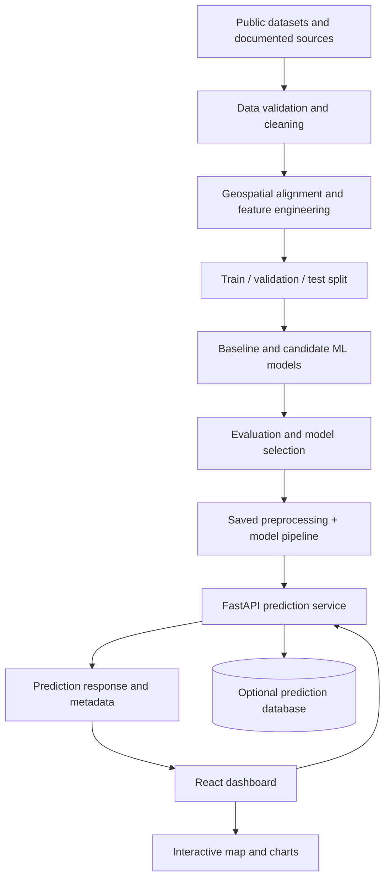
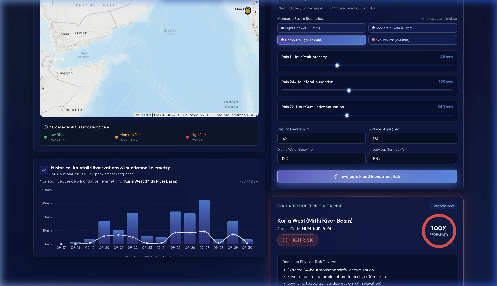
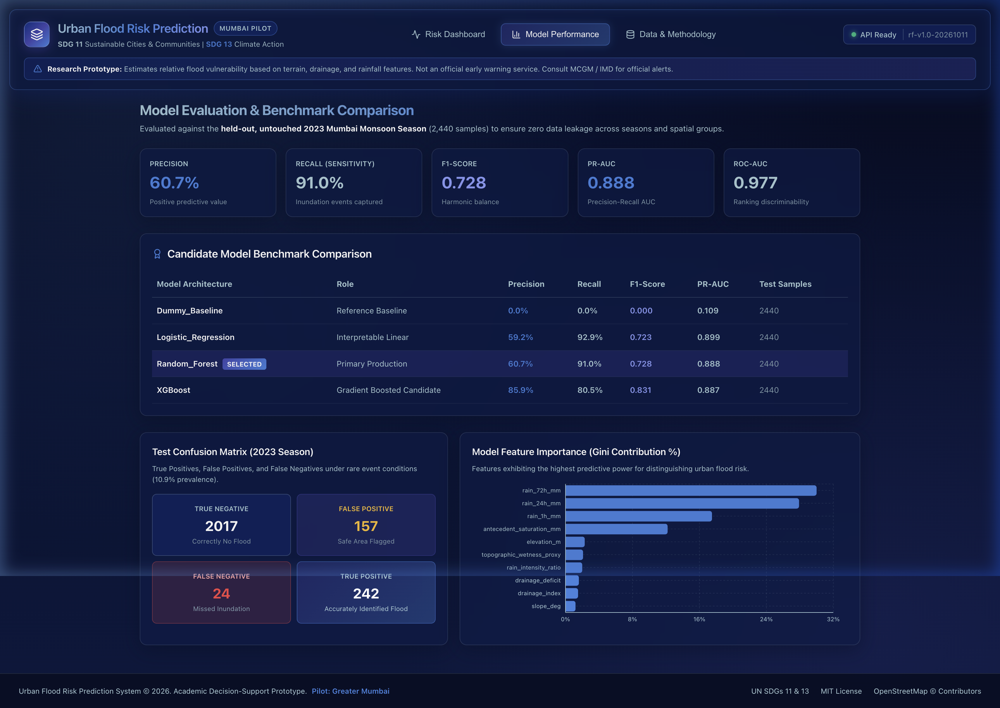
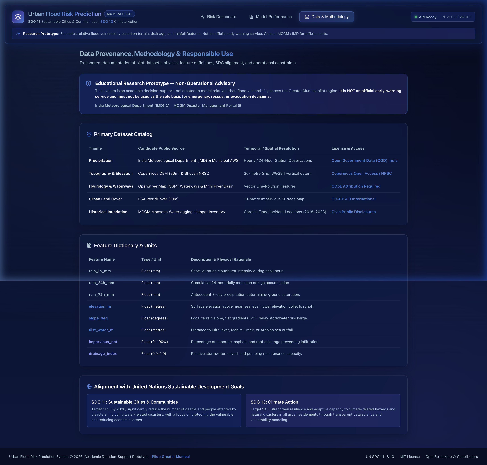

# Urban Flood Risk Prediction System
### Machine Learning + Geospatial Analytics + Full-Stack Web Application
**SDGs:** SDG 11 — Sustainable Cities and Communities | SDG 13 — Climate Action

> An educational decision-support prototype that estimates relative urban flood risk for geographic locations from rainfall, terrain, drainage, land-surface, and historical flood data. It is not an official early-warning service and must not be used as the sole basis for emergency or evacuation decisions.

<p align="center">
  
</p>

---

## Table of Contents

1. [Project Overview](#1-project-overview)
2. [Problem Statement](#2-problem-statement)
3. [Objectives](#3-objectives)
4. [Target Users](#4-target-users)
5. [Scope and Limitations](#5-scope-and-limitations)
6. [Proposed Solution](#6-proposed-solution)
7. [Key Features](#7-key-features)
8. [System Architecture](#8-system-architecture)
9. [Technology Stack](#9-technology-stack)
10. [Repository Structure](#10-repository-structure)
11. [Dataset Plan](#11-dataset-plan)
12. [Data Dictionary](#12-data-dictionary)
13. [Machine Learning Methodology](#13-machine-learning-methodology)
14. [Risk Classification](#14-risk-classification)
15. [Model Evaluation](#15-model-evaluation)
16. [Backend API Design](#16-backend-api-design)
17. [Frontend Design](#17-frontend-design)
18. [Database Design](#18-database-design)
19. [Map and Geospatial Processing](#19-map-and-geospatial-processing)
20. [Implementation Roadmap](#20-implementation-roadmap)
21. [Local Development Setup](#21-local-development-setup)
22. [Training and Inference Workflow](#22-training-and-inference-workflow)
23. [Testing Strategy](#23-testing-strategy)
24. [Security, Reliability, and Responsible Use](#24-security-reliability-and-responsible-use)
25. [Deployment Plan](#25-deployment-plan)
26. [Expected Deliverables](#26-expected-deliverables)
27. [Future Enhancements](#27-future-enhancements)
28. [Success Criteria](#28-success-criteria)
29. [References and Dataset Discovery](#29-references-and-dataset-discovery)
30. [Contributing](#30-contributing)
31. [License](#31-license)

---

## 1. Project Overview

Urban flooding can occur when intense rainfall combines with low-lying terrain, limited drainage capacity, impermeable surfaces, high water levels, and other local conditions. This project proposes a web-based system that combines machine learning with geospatial visualization to estimate relative flood risk at a location.

Users will be able to view a map, choose a location or area, inspect available environmental features, request a risk prediction, and see the result as a risk category with supporting factors.

### Project at a glance

| Item | Description |
|---|---|
| Project name | Urban Flood Risk Prediction System |
| Domain | Machine Learning, Climate Resilience, Geospatial Analytics |
| SDGs | SDG 11 and SDG 13 |
| ML task | Classification; optional probability estimation |
| Baseline model | Random Forest Classifier |
| Comparison model | XGBoost Classifier |
| API | FastAPI |
| Frontend | React + TypeScript |
| Map | Leaflet with OpenStreetMap tiles, subject to tile-provider terms |
| Data processing | Python, Pandas, NumPy, GeoPandas |
| Model evaluation | Scikit-learn |
| Optional database | PostgreSQL + PostGIS, or MongoDB for a simpler prototype |
| Initial deployment | Separate frontend and API services |

### Important distinction

The system estimates **relative risk based on the data and model available**. It does not directly measure water depth, guarantee that flooding will or will not occur, or replace official weather alerts, hydrological models, or emergency services.

---

## 2. Problem Statement

Urban areas can experience flooding during heavy rainfall due to a combination of topography, drainage limitations, land use, river or coastal influence, and the condition of local infrastructure. Historical flood information and environmental measurements may be spread across different datasets, making it difficult to examine local risk in one place.

The project will build a data-driven prototype that:

1. Combines historical flood labels with relevant geographic and weather features.
2. Trains and evaluates machine learning models for flood-risk classification.
3. Returns a risk category and, only when properly calibrated, an estimated class probability.
4. Displays predictions and supporting information on an interactive map.
5. Communicates uncertainty, data coverage, and model limitations clearly.

**Research question:** How effectively can available rainfall, terrain, drainage, land-cover, and historical flood features identify locations associated with higher flood risk, when evaluated on locations or time periods not used during training?

---

## 3. Objectives

- Collect and document suitable public flood, rainfall, elevation, and land-cover datasets.
- Build a reproducible data-cleaning and geospatial feature-engineering pipeline.
- Explore class imbalance, missing values, outliers, and spatial/temporal coverage.
- Train a simple baseline and compare Random Forest with XGBoost.
- Prevent data leakage by separating training and test data by time and/or geographic area where feasible.
- Evaluate models using precision, recall, F1-score, confusion matrix, and PR-AUC or ROC-AUC as appropriate.
- Serve predictions through a documented REST API.
- Create a responsive dashboard with an interactive map and risk legend.
- Record dataset provenance, model version, prediction timestamp, and known limitations.
- Demonstrate how the prototype may support climate adaptation planning without presenting it as an official warning system.

---

## 4. Target Users

- Students and researchers studying climate resilience.
- Urban planners and local civic teams exploring historical risk patterns.
- Disaster-management researchers evaluating open data.
- Communities seeking to understand general environmental risk, alongside official sources.

The first version is a student/research prototype. It is not a certified operational tool for government decisions.

---

## 5. Scope and Limitations

### Included in the first version

- One selected pilot city or region.
- Historical dataset analysis and model training.
- Location-based prediction where the required features are available.
- Low, medium, and high risk display, subject to a documented label-generation method.
- Map visualization, model metrics, and basic prediction history.
- Reproducible setup instructions.

### Not promised in the first version

- Guaranteed real-time flood forecasts.
- Street-level predictions without sufficiently detailed training labels and input data.
- Accurate drainage-capacity estimates where drainage data is unavailable.
- Automatic emergency alerts or evacuation recommendations.
- Claims of city-wide accuracy based on a small or geographically narrow dataset.

**Recommended pilot:** Start with one city, district, or well-documented flood-prone study area. Mumbai may be a practical candidate if suitable data coverage can be obtained, but verify dataset availability and spatial resolution before committing to it.

---

## 6. Proposed Solution

### User workflow

1. Open the dashboard.
2. View the pilot area's map and the coverage of available data.
3. Select a location or choose a supported grid cell/administrative area.
4. Load or enter the relevant feature values.
5. Request a prediction from the API.
6. View the estimated risk category, model confidence information where appropriate, and key contributing factors.
7. Review the model's limitations and links to official information.

### Model input examples

- Recent rainfall total over defined time windows.
- Forecast rainfall, only if a suitable and licensed data source is integrated.
- Elevation above a consistent vertical datum.
- Slope and local terrain position.
- Distance to river, stream, coast, or mapped water body, where relevant.
- Land-cover or impervious-surface percentage.
- Drainage information, only if reliable and geographically aligned.
- Historical flood occurrence or inundation labels.
- Optional soil, tide, or water-level features where reliable data exists.

The features actually used must match the dataset available at prediction time. Do not silently substitute missing features with invented values.

---

## 7. Key Features

### Minimum viable product (MVP)

- [ ] Project overview dashboard.
- [ ] Interactive map with a legend for Low / Medium / High modelled risk.
- [ ] Location or grid-cell selection.
- [ ] Prediction endpoint connected to a saved ML pipeline.
- [ ] Risk result panel with input values and data timestamp.
- [ ] Model performance page showing evaluation metrics.
- [ ] Dataset information and limitations page.
- [ ] Input validation and understandable error messages.
- [ ] Unit tests for feature preparation and API validation.
- [ ] README, reproducible environment, and model card.

### Optional enhancements

- [ ] Time-series rainfall charts.
- [ ] Side-by-side comparison of Random Forest and XGBoost.
- [ ] Download of a prediction report.
- [ ] User-defined scenario analysis (clearly labelled as hypothetical).
- [ ] Historical flood-event layers.
- [ ] Scheduled ingestion of an approved data source.
- [ ] Model drift and data-quality monitoring.
- [ ] Admin-only dataset and model version management.

---

## 8. System Architecture



### Architecture principles

- Train the model offline; do not retrain it for every API request.
- Save preprocessing and model steps together in a versioned pipeline.
- Keep model input features, order, units, and types consistent between training and inference.
- Keep data ingestion separate from the user-facing prediction endpoint.
- Return the model version and relevant data timestamp with each result.
- Never expose secrets, raw credentials, or unrestricted write access in the frontend.

---

## 9. Technology Stack

| Layer | Recommended tools | Purpose |
|---|---|---|
| Language | Python | Data processing and ML |
| Data analysis | Pandas, NumPy | Cleaning and analysis |
| Geospatial | GeoPandas, Shapely, Rasterio as needed | Vector/raster data processing |
| ML baseline | Scikit-learn | Pipeline, Random Forest, evaluation |
| Boosting | XGBoost | Candidate model comparison |
| API | FastAPI, Pydantic, Uvicorn | Validated prediction service |
| Frontend | React, TypeScript, Vite | Dashboard UI |
| Styling | Tailwind CSS or CSS modules | Responsive interface |
| Charts | Recharts or Chart.js | Rainfall and model metrics |
| Map | Leaflet / React Leaflet | Map and risk layers |
| Map data | GeoJSON or vector tiles | Geographic display |
| Database | PostgreSQL + PostGIS (optional) | Spatial data and query support |
| Alternative database | MongoDB | Simpler application records |
| Testing | Pytest, HTTPX, Vitest | Backend and frontend tests |
| Version control | Git and GitHub | Source control |
| Deployment | Any compatible API host + static frontend host | Publish the prototype |
| Containers | Docker and Docker Compose (optional) | Repeatable deployment |

Pin compatible dependency versions in lock files or a requirements file after confirming the working environment.

---

## 10. Repository Structure

```text
urban-flood-risk-prediction/
├── README.md
├── LICENSE
├── .gitignore
├── .env.example
├── docker-compose.yml                 # Optional
│
├── data/
│   ├── README.md                      # Dataset links, licenses, provenance
│   ├── raw/                           # Downloaded files; normally not committed
│   ├── interim/                       # Intermediate processing outputs
│   ├── processed/                     # Model-ready features
│   └── sample/                        # Small synthetic/example files only
│
├── notebooks/
│   ├── 01_data_exploration.ipynb
│   ├── 02_geospatial_exploration.ipynb
│   ├── 03_feature_engineering.ipynb
│   └── 04_model_experiments.ipynb
│
├── ml/
│   ├── README.md
│   ├── configs/
│   │   └── baseline.yaml
│   ├── src/
│   │   ├── __init__.py
│   │   ├── data/
│   │   │   ├── download.py
│   │   │   ├── validate.py
│   │   │   └── preprocess.py
│   │   ├── features/
│   │   │   ├── build_features.py
│   │   │   └── geospatial.py
│   │   ├── models/
│   │   │   ├── train.py
│   │   │   ├── evaluate.py
│   │   │   ├── predict.py
│   │   │   └── calibrate.py
│   │   └── utils/
│   │       ├── config.py
│   │       └── logging_config.py
│   ├── artifacts/
│   │   └── .gitkeep                  # Avoid committing large/unsafe artifacts by default
│   ├── reports/
│   │   ├── figures/
│   │   └── metrics/
│   ├── tests/
│   │   ├── test_preprocess.py
│   │   └── test_features.py
│   └── requirements.txt
│
├── backend/
│   ├── app/
│   │   ├── main.py
│   │   ├── api/
│   │   │   ├── health.py
│   │   │   ├── predictions.py
│   │   │   └── metrics.py
│   │   ├── schemas/
│   │   │   ├── prediction.py
│   │   │   └── common.py
│   │   ├── services/
│   │   │   ├── model_service.py
│   │   │   └── prediction_service.py
│   │   ├── core/
│   │   │   ├── config.py
│   │   │   └── logging_config.py
│   │   └── db/                       # Optional
│   ├── tests/
│   │   ├── test_health.py
│   │   └── test_predictions.py
│   ├── requirements.txt
│   └── Dockerfile
│
├── frontend/
│   ├── public/
│   │   └── sample-area.geojson       # Optional, small and licensed
│   ├── src/
│   │   ├── api/
│   │   │   └── predictions.ts
│   │   ├── components/
│   │   │   ├── AppHeader.tsx
│   │   │   ├── RiskBadge.tsx
│   │   │   ├── RiskLegend.tsx
│   │   │   ├── MapView.tsx
│   │   │   ├── RainfallChart.tsx
│   │   │   └── DataFreshness.tsx
│   │   ├── pages/
│   │   │   ├── Dashboard.tsx
│   │   │   ├── ModelPerformance.tsx
│   │   │   └── AboutData.tsx
│   │   ├── types/
│   │   │   └── prediction.ts
│   │   ├── App.tsx
│   │   └── main.tsx
│   ├── .env.example
│   ├── package.json
│   └── Dockerfile
│
├── docs/
│   ├── architecture.md
│   ├── dataset-catalog.md
│   ├── data-dictionary.md
│   ├── model-card.md
│   ├── api.md
│   └── screenshots/
│
└── scripts/
    ├── validate_data.py
    └── run_local.sh
```

**Note:** Create only the folders needed for the current phase. Avoid committing large raw datasets, secrets, private data, or model artifacts unless the repository policy and licenses explicitly allow it.

---

## 11. Dataset Plan

A useful model depends more on reliable labels and aligned features than on the number of algorithms used. Before modelling, select a study area and build a dataset catalog that records each source's geographic coverage, time period, resolution, units, update frequency, license, and limitations.

### Potential public sources to investigate

| Data need | Candidate source | What to verify |
|---|---|---|
| Weather and rainfall | [India Meteorological Department (IMD)](https://mausam.imd.gov.in/) | Available historical observations, station coverage, access terms, and time resolution |
| Indian geospatial data | [Bhuvan / NRSC](https://bhuvan.nrsc.gov.in/) | Relevant layers, coverage, download/API conditions, and permitted use |
| Elevation and terrain | [Copernicus Data Space Ecosystem](https://dataspace.copernicus.eu/) | DEM product, spatial resolution, vertical datum, license, and coverage |
| Global elevation | [USGS EarthExplorer](https://earthexplorer.usgs.gov/) | Available DEM products, download conditions, resolution, and area coverage |
| Global hazard information | [NASA Earthdata](https://www.earthdata.nasa.gov/) | Flood or precipitation products, time coverage, resolution, and access requirements |
| Disaster information | [DesInventar Sendai](https://www.desinventar.net/) | Country/region availability, event definitions, completeness, and access |
| Satellite flood observations | [Copernicus Emergency Management Service](https://emergency.copernicus.eu/) | Relevant activation products, event coverage, and usage conditions |
| Land cover | [ESA WorldCover](https://worldcover2021.esa.int/) | Product year, resolution, class definitions, and license |
| Global research datasets | [Google Earth Engine Data Catalog](https://developers.google.com/earth-engine/datasets) | Dataset terms, processing requirements, and whether Earth Engine access is needed |
| OpenStreetMap features | [OpenStreetMap](https://www.openstreetmap.org/) | Feature completeness, attribution, ODbL obligations, and local drainage/waterway coverage |

These are **candidate discovery sources, not a guarantee that every required layer is freely downloadable at the needed resolution**. Verify current availability, terms, and data quality before choosing a source. Cite the exact dataset/product and version in the project's dataset catalog.

### Recommended initial dataset strategy

1. Choose one pilot region.
2. Find historical flood occurrence or inundation labels for that region.
3. Obtain rainfall observations for matching locations and dates.
4. Obtain a digital elevation model and derive terrain features.
5. Add land-cover and distance-to-water features if their quality is sufficient.
6. Add drainage data only when a reliable and appropriately licensed source is available.
7. Align all records to a consistent spatial unit and time window.
8. Record missingness and spatial/temporal coverage before training.

### Important label warning

Do not create the target label from the same features used as model inputs in a way that makes the task circular. If no defensible low/medium/high ground-truth labels exist, begin with a clearly described **binary historical flood occurrence target** or a suitable event-based target, then explain how risk categories are derived. A synthetic dataset may test the software pipeline, but it cannot demonstrate real-world predictive performance.

---

## 12. Data Dictionary

The final schema depends on the selected datasets. A possible model-ready table is shown below.

| Field | Type | Example unit / format | Description |
|---|---|---|---|
| `location_id` | string | grid or area ID | Stable identifier for a spatial unit |
| `latitude` | float | decimal degrees | Latitude in WGS84 for display |
| `longitude` | float | decimal degrees | Longitude in WGS84 for display |
| `event_time` | datetime | ISO 8601 | Observation or event timestamp |
| `rain_1h_mm` | float | millimetres | Rainfall during previous hour, if available |
| `rain_24h_mm` | float | millimetres | Rainfall during previous 24 hours |
| `rain_72h_mm` | float | millimetres | Rainfall during previous 72 hours |
| `elevation_m` | float | metres | Elevation using documented vertical reference |
| `slope_deg` | float | degrees | Terrain slope derived from elevation |
| `dist_water_m` | float | metres | Distance to mapped water body, where relevant |
| `impervious_pct` | float | 0–100 | Estimated impervious surface percentage |
| `drainage_index` | float / null | documented index | Drainage feature, only if defined and supported by data |
| `flood_observed` | integer / boolean | 0 or 1 | Historical flood label based on source definition |
| `risk_class` | category | low/medium/high | Optional target only if defensibly labelled |

### Data quality rules

- Specify units, coordinate reference systems, time zones, and missing-value conventions.
- Check duplicates, invalid coordinates, impossible values, and inconsistent timestamps.
- Ensure rainfall windows do not use information from after the prediction time.
- Avoid using event outcome fields or post-event observations as predictors for pre-event forecasts.
- Keep source identifiers and processing metadata for traceability.
- Fit imputers, scalers, feature selectors, and other learned transformations on training data only.
- Do not fill unknown drainage values with zero unless zero has a valid meaning.

---

## 13. Machine Learning Methodology

### Step 1: Exploratory data analysis

Examine:

- Number of records and unique locations.
- Flood/non-flood label distribution.
- Missing values and duplicates.
- Rainfall and elevation distributions.
- Flood events by season, year, and area.
- Geographic gaps and sampling bias.
- Feature correlations and potential target leakage.

Create plots such as a label-count chart, rainfall distribution, missingness chart, and map of observed flood records.

### Step 2: Feature engineering

Potential features include:

- Rolling rainfall totals for fixed, documented time windows.
- Antecedent rainfall, where timestamped data supports it.
- Terrain slope and local low-point indicators derived from a DEM.
- Distance to rivers or mapped drainage features.
- Land-cover or imperviousness statistics for each grid cell.
- Season/month indicators when justified and available at prediction time.
- Past-event counts calculated using training-period data only.

Features must be computed consistently for training, testing, and live inference.

### Step 3: Establish a baseline

Start with a simple baseline such as predicting the majority class or a basic Decision Tree. Then train a Random Forest Classifier. A baseline makes it possible to determine whether more complex models genuinely improve performance.

### Step 4: Train candidate models

Candidate models:

1. DummyClassifier — reference baseline.
2. Logistic Regression or Decision Tree — interpretable benchmark.
3. Random Forest — robust tabular baseline.
4. XGBoost — boosted-tree comparison when dataset size and dependency support justify it.

Use a `Pipeline` or equivalent to bundle preprocessing and modelling. Handle class imbalance using class weights or training-only resampling where appropriate. Do not apply resampling before splitting the data.

### Step 5: Use a defensible data split

Random row-level splitting can produce overly optimistic results when nearby locations or records from the same flood event appear in both train and test sets.

Prefer one or both of the following when the data supports it:

- **Temporal split:** train on earlier periods and test on a later, untouched period.
- **Spatial/group split:** keep geographic areas or flood events grouped so related samples do not leak across splits.

Use a separate validation set or cross-validation strategy to tune hyperparameters. Reserve the final test set for one-time final evaluation.

### Step 6: Evaluate and select the model

Compare models using relevant metrics and inspect errors by location, season, event, and risk group. Choose a model based on the project's use case, not accuracy alone.

### Step 7: Save the full pipeline

Save the fitted preprocessing and estimator as one versioned artifact. Load only trusted artifacts created by your own pipeline; pickle-based formats can execute code when loaded from untrusted sources.

### Step 8: Explain the result

Use feature importance or SHAP (if appropriate) to explain model behaviour. Describe these as associations or model contributions, not proof of causation. Check whether explanations are stable across geographic areas and time periods.

---

## 14. Risk Classification

The project should distinguish the **model target** from the **display category**.

### Option A — Model predicts binary flood occurrence

Train the model to estimate whether a defined flood event was observed within a specified place and time window. If calibrated probabilities are justified, a display layer may group these estimates into Low / Medium / High categories using thresholds selected on validation data and documented with the intended use.

Do not label arbitrary thresholds as official flood warning levels.

### Option B — Model predicts three classes directly

Use this only if the source data provides credible, documented low/medium/high labels or a defensible, independently specified methodology for creating them.

### Example API display

```json
{
  "location_id": "sample-grid-001",
  "risk_class": "medium",
  "estimated_probability": 0.58,
  "probability_is_calibrated": false,
  "model_version": "rf-baseline-1",
  "data_timestamp": "2026-01-01T00:00:00Z",
  "limitations": [
    "Demonstration response",
    "Not an official flood warning"
  ]
}
```

This is an **illustrative response only**, not a real model result. Do not display made-up probabilities as predictions. If the model's probability calibration has not been validated, show that clearly or omit the probability from the user interface.

---

## 15. Model Evaluation

### Recommended metrics

| Metric | Why it matters |
|---|---|
| Precision | How many predicted flood cases were actually labelled flood cases |
| Recall / Sensitivity | How many labelled flood cases the model identifies |
| F1-score | Balance of precision and recall |
| PR-AUC | Useful for imbalanced positive flood-event labels |
| ROC-AUC | Measures ranking performance across thresholds, where appropriate |
| Confusion matrix | Shows false positives and false negatives |
| Brier score / calibration plot | Assesses probability quality when probabilities are produced |
| Spatial/temporal breakdown | Shows whether performance transfers across areas or time periods |

Report class-wise precision, recall, and F1, along with sample counts and the exact test split. Accuracy should not be the only headline metric, especially when flood events are rare.

### Model report template

| Model | Split method | Precision | Recall | F1 | PR-AUC | Notes |
|---|---|---:|---:|---:|---:|---|
| Dummy baseline | To be measured | — | — | — | — | Reference |
| Random Forest | To be measured | — | — | — | — | Candidate baseline |
| XGBoost | To be measured | — | — | — | — | Candidate comparison |

Fill in the table only after running experiments. Do not claim results before evaluating on held-out data.

---

## 16. Backend API Design

Use FastAPI and Pydantic for input validation and API documentation.

### Suggested endpoints

| Method | Endpoint | Purpose |
|---|---|---|
| `GET` | `/health` | Basic service health |
| `GET` | `/api/v1/model-info` | Model version, features, training metadata |
| `GET` | `/api/v1/metrics` | Published evaluation metrics |
| `POST` | `/api/v1/predictions` | Predict for one supported location/feature record |
| `POST` | `/api/v1/predictions/batch` | Optional bounded batch predictions |
| `GET` | `/api/v1/areas` | List supported areas or grid cells |
| `GET` | `/api/v1/areas/{location_id}` | Return metadata for a supported area |

### Example request

```json
{
  "location_id": "sample-grid-001",
  "features": {
    "rain_24h_mm": 82.0,
    "rain_72h_mm": 140.0,
    "elevation_m": 8.5,
    "slope_deg": 1.8,
    "impervious_pct": 76.0
  }
}
```

These values are fabricated examples for documenting the API, not measurements from a real location. The actual feature list must match the trained model and data schema.

### Example response shape

```json
{
  "prediction_id": "generated-by-api",
  "location_id": "sample-grid-001",
  "risk_class": "medium",
  "estimated_probability": null,
  "model_version": "rf-baseline-1",
  "prediction_created_at": "generated-by-api",
  "input_data_timestamp": null,
  "warnings": [
    "Illustrative schema: replace with validated model output",
    "Not an official flood warning"
  ]
}
```

### API requirements

- Reject missing, invalid, out-of-range, or unexpected features with clear errors.
- Validate coordinates and confirm the requested location is within the supported region.
- Do not silently predict when required input data is unavailable or stale.
- Return a stable model version and data timestamp.
- Bound batch size and request size.
- Configure CORS for the actual frontend origin.
- Add rate limiting and authentication if required by the deployment.
- Never expose secrets or internal filesystem paths.
- Keep health checks separate from prediction correctness checks.
- Publish OpenAPI docs through FastAPI's `/docs` endpoint in development; restrict or disable them in production if appropriate.

---

## 17. Frontend Design

Build a responsive React dashboard with a clear, accessible interface.

### Application Interface Showcase

| Risk Dashboard & Geospatial Map | Real-Time Prediction & Circular Risk Gauge |
|:---:|:---:|
|  |  |
| *Interactive Leaflet GIS Map with floating layer HUD, monitoring stations & scenario sliders* | *Futuristic circular SVG risk gauge (88.0%), animated percentage & physical driver breakdown* |

| Model Performance & Benchmark Evaluation | Data Provenance & Responsible Use |
|:---:|:---:|
|  |  |
| *Held-out 2023 season test metrics, candidate comparison table & Gini importance* | *Primary dataset catalog, physical feature definitions & non-operational advisory* |

### Page 1: Dashboard

Components:

- Header with project name and SDG alignment.
- Summary cards for supported area, data freshness, and model version.
- Interactive map and legend.
- Search or selection control for supported locations.
- Risk result panel.
- Rainfall history chart when actual time-series data exists.
- Visible data-source and limitations notices.

### Page 2: Model Performance

- Selected model and version.
- Test split description.
- Precision, recall, F1, PR-AUC, and confusion matrix.
- Comparison with the baseline.
- Performance by region/time period, where sample size supports it.
- Last evaluation date and data version.

### Page 3: Data and Methodology

- Data sources, links, licenses, resolutions, and periods.
- Feature definitions and units.
- Label-generation method.
- Missing data and known coverage gaps.
- Risk-class methodology.
- Model limitations and appropriate-use notice.

### UI states to implement

- Loading.
- Valid prediction.
- Invalid input.
- Unsupported location.
- Missing or stale input data.
- API unavailable.
- No model artifact installed.
- Map/data layer unavailable.

### Accessibility

Use keyboard-accessible controls, adequate text contrast, meaningful labels, and a textual alternative to color-only risk indicators. Include symbols or words as well as map colors.

---

## 18. Database Design

A database is optional for the first local prototype. Add one when prediction history, user accounts, spatial queries, or data-ingestion records are needed.

### Suggested relational tables

**`locations`**
- `id`
- `name`
- `latitude`
- `longitude`
- `geometry` (if using PostGIS)
- `source_id`

**`observations`**
- `id`
- `location_id`
- `observed_at`
- `feature_name`
- `feature_value`
- `unit`
- `source_id`

**`predictions`**
- `id`
- `location_id`
- `created_at`
- `risk_class`
- `estimated_probability` (nullable)
- `model_version`
- `input_data_timestamp`
- `request_metadata` (exclude secrets and unnecessary personal data)

**`datasets`**
- `id`
- `name`
- `version`
- `source_url`
- `license`
- `coverage_start`
- `coverage_end`
- `ingested_at`

Store geospatial geometries in a consistent coordinate reference system and document any reprojection. Do not store sensitive personal information unless strictly necessary.

---

## 19. Map and Geospatial Processing

### Coordinate reference systems

- Use a documented projected CRS for distance and area calculations.
- Use WGS84 latitude/longitude for web-map display where appropriate.
- Reproject data explicitly before combining layers or calculating distances.
- Record DEM vertical units and datum; horizontal coordinates alone are not enough.

### Map layers

1. Basemap.
2. Pilot-area boundary.
3. Historical observed flood locations or inundation polygons.
4. Modelled risk by grid cell or supported area.
5. Optional waterway and terrain layers.

### Geospatial cautions

- A map point is not automatically a reliable street-level prediction.
- Spatial resolution must match the underlying evidence.
- Do not imply coverage in areas without data.
- Use an appropriate grid or administrative unit and disclose its size.
- Follow map tile-provider usage policies and provide required attribution.
- Keep historical observed flood layers visually distinct from model predictions.

---

## 20. Implementation Roadmap

### Phase 1 — Define the study

- [ ] Choose one city/region.
- [ ] Define the prediction unit (grid cell, ward, or event location).
- [ ] Define what “flood occurrence” means and the time window.
- [ ] Write down the intended user and limitations.

**Deliverable:** Study-area and target-definition document.

### Phase 2 — Find and validate data

- [ ] Create `docs/dataset-catalog.md`.
- [ ] Verify source links, licenses, formats, units, and geographic coverage.
- [ ] Download a small sample of each chosen source.
- [ ] Check time overlap and spatial resolution.
- [ ] Identify reliable labels and document their limitations.

**Deliverable:** Dataset catalog and initial data-quality report.

### Phase 3 — Prepare the data

- [ ] Standardize timestamps, units, and coordinate reference systems.
- [ ] Clean invalid records and duplicates.
- [ ] Align observations to a common grid/area and prediction time.
- [ ] Build the feature table.
- [ ] Define temporal and/or spatial train/validation/test splits.
- [ ] Save reproducible processing scripts.

**Deliverable:** Versioned processed dataset and data dictionary.

### Phase 4 — Train and evaluate ML models

- [ ] Establish a DummyClassifier baseline.
- [ ] Train a Random Forest.
- [ ] Compare with XGBoost if justified.
- [ ] Tune on training/validation data only.
- [ ] Evaluate on untouched test data.
- [ ] Examine false negatives, geographic errors, and calibration.
- [ ] Save the complete pipeline and metrics.

**Deliverable:** Model artifact, metrics report, and model card.

### Phase 5 — Build the API

- [ ] Create the FastAPI application.
- [ ] Load the saved pipeline once at startup.
- [ ] Validate request schemas and feature order.
- [ ] Implement health, model-info, metrics, and prediction endpoints.
- [ ] Add tests for valid, invalid, and missing inputs.
- [ ] Document API responses and errors.

**Deliverable:** Working local API with automated tests.

### Phase 6 — Build the dashboard

- [ ] Create the React application.
- [ ] Implement map and supported-area selection.
- [ ] Add prediction and risk-result panels.
- [ ] Display real model metrics and data freshness.
- [ ] Add loading, empty, error, and unavailable-data states.
- [ ] Test desktop and mobile layouts.

**Deliverable:** Connected web dashboard.

### Phase 7 — Integrate and validate

- [ ] Test frontend-to-API integration.
- [ ] Verify feature units and ordering end to end.
- [ ] Confirm map locations match returned predictions.
- [ ] Verify that demo data is clearly labelled.
- [ ] Review performance and failure handling.
- [ ] Ask a domain-informed reviewer to examine the methodology if possible.

**Deliverable:** Reproducible end-to-end MVP.

### Phase 8 — Deploy and document

- [ ] Add environment configuration.
- [ ] Build production frontend and API images or deployment artifacts.
- [ ] Deploy to selected hosting providers.
- [ ] Configure CORS, secrets, logs, and health checks.
- [ ] Document limitations and official information sources.
- [x] Add screenshots and application walkthrough (see `docs/screenshots/`).

**Deliverable:** Demo deployment and final project report.

---

## 21. Local Development Setup & Installation

### Prerequisites

- **Python 3.10+** (tested on Python 3.12)
- **Node.js 18+ & npm** (tested on Node.js 20/22)
- **Git**
- Optional: **Docker & Docker Compose**
- macOS ARM note: If using native Apple Silicon and training XGBoost, install OpenMP via Homebrew: `brew install libomp`

---

### Method 1: One-Click Local Quickstart (Recommended)

The repository includes an automated orchestration script that verifies dependencies, creates the Python virtual environment, starts the FastAPI backend, and boots the Vite frontend:

```bash
# Clone the repository
git clone https://github.com/Dheeraj2002kumar/urban-food-risk-prediction.git
cd urban-food-risk-prediction

# Make executable and run
chmod +x scripts/run_local.sh
./scripts/run_local.sh
```

This starts:
- **FastAPI Backend**: `http://127.0.0.1:8000` (Docs at `http://127.0.0.1:8000/docs`)
- **React Frontend**: `http://127.0.0.1:5173`

---

### Method 2: Docker Compose (Zero Configuration)

To run the entire system inside isolated production-ready containers:

```bash
docker compose up --build
```

- Frontend: `http://localhost:5173`
- Backend API: `http://localhost:8000`
- To stop the services: `docker compose down`

---

### Method 3: Step-by-Step Manual Setup

#### Step 1: Clone the Repository & Configure Environment

```bash
git clone https://github.com/Dheeraj2002kumar/urban-food-risk-prediction.git
cd urban-food-risk-prediction

# Copy environment variable templates
cp .env.example .env
cp frontend/.env.example frontend/.env
```

#### Step 2: Python Environment & Machine Learning Pipeline

```bash
# Create and activate virtual environment
python3 -m venv .venv
source .venv/bin/activate       # On Windows: .venv\Scripts\Activate.ps1

# Upgrade pip and install dependencies
pip install --upgrade pip
pip install -r ml/requirements.txt
pip install -r backend/requirements.txt

# (Optional) Retrain and evaluate the models on held-out 2023 season
python scripts/validate_data.py
python ml/src/features/build_features.py
python ml/src/models/train.py
```

#### Step 3: Run the Automated Unit Test Suite

```bash
pytest ml/tests backend/tests -v
```
*(All 10 unit tests should pass: feature transformations, preprocessing, health checks, and prediction endpoints).*

#### Step 4: Start the FastAPI Backend Server

```bash
# On macOS ARM, export OpenMP library path if needed:
export DYLD_LIBRARY_PATH=/opt/homebrew/opt/libomp/lib

# Start Uvicorn
PYTHONPATH=. uvicorn backend.app.main:app --host 127.0.0.1 --port 8000 --reload
```

Verify backend health:
```bash
curl http://127.0.0.1:8000/health
```

#### Step 5: Start the React + Vite Frontend

In a second terminal window:

```bash
cd frontend
npm install
npm run dev
```

Navigate to `http://localhost:5173` in your web browser.

---

### Available Services & Documentation Endpoints

| Service / Asset | URL / File Path | Description |
|---|---|---|
| **Web GIS Dashboard** | `http://localhost:5173` | Interactive Leaflet map, scenario sliders, circular risk gauge |
| **FastAPI Interactive Docs** | `http://localhost:8000/docs` | Swagger UI for exploring and testing API endpoints |
| **API Health Check** | `http://localhost:8000/health` | Service status, model version, and pipeline readiness |
| **System Technical Guide** | [`docs.md`](docs.md) | 387-line comprehensive architecture and data documentation |
| **Lean Canvas Presentation** | [`lean-canvas.pptx`](lean-canvas.pptx) / [`.ppt`](lean-canvas.ppt) | 10-slide 16:9 business model and SDG pitch presentation |
| **Formal Concept Note** | [`concept-note.pdf`](concept-note.pdf) / [`.md`](concept-note.md) | 6-page publication-grade project proposal document |

---

## 22. Training and Inference Workflow

A recommended workflow is:

```text
Raw sources
   ↓
Validate schemas, timestamps, units, and coordinates
   ↓
Clean and align spatial/temporal records
   ↓
Build features without future information
   ↓
Split by time and/or geographic group
   ↓
Fit preprocessing on training data
   ↓
Train baseline and candidate models
   ↓
Tune using training/validation data
   ↓
Evaluate once on held-out test data
   ↓
Save pipeline + feature schema + metrics + version
   ↓
Load pipeline in FastAPI
   ↓
Validate request and produce prediction
   ↓
Return risk class + metadata + warnings
```

### Training script responsibilities

`ml/src/models/train.py` should:

1. Load a configured processed dataset.
2. Validate required columns and target labels.
3. use a reproducible random seed where relevant.
4. Apply a defensible temporal/spatial split.
5. Fit the preprocessing/model pipeline on training data.
6. Tune only using training/validation data.
7. Save the selected pipeline to a configured artifact path.
8. Record model version, feature names, data version, and training date.

### Inference script responsibilities

`ml/src/models/predict.py` should:

1. Load a trusted, versioned pipeline.
2. Validate that required features exist and have expected units/types.
3. Reject unsupported or incomplete input rather than inventing missing values.
4. Apply the exact saved preprocessing pipeline.
5. Return the predicted class and any validated probability.
6. Include warnings when coverage or freshness is insufficient.

Use command-line arguments or a configuration file for data and artifact paths instead of hard-coding machine-specific paths.

---

## 23. Testing Strategy

### Data and ML tests

- Required columns exist.
- Units and timestamp formats are valid.
- No train/test overlap exists for the selected grouping strategy.
- Transformations are fitted on training data only.
- Prediction output contains valid labels.
- Probability output is finite and within `[0, 1]`, if provided.
- Metrics are calculated against the correct held-out labels.
- Model artifact and feature schema versions match.

### API tests

- Health endpoint returns the expected status.
- Valid request returns the documented response schema.
- Missing or malformed features return a validation error.
- Unsupported locations are rejected.
- Missing model artifact produces a clear service error.
- Batch requests respect size limits.
- CORS configuration matches the intended frontend origin.

### Frontend tests

- Map legend is visible and accessible.
- API errors are shown clearly.
- Risk is not communicated through color alone.
- Unsupported or stale data is disclosed.
- Prediction details match the API response.
- Layout works on small and large screens.

### End-to-end acceptance test

Given a supported location and a complete, valid feature record, the dashboard sends a request to the API and displays the returned model version, risk category, and applicable warnings. If the input is invalid or unavailable, it shows a clear error rather than a fabricated prediction.

---

## 24. Security, Reliability, and Responsible Use

- Treat all external datasets as untrusted until validated.
- Keep API keys and database credentials outside source control.
- Restrict CORS and database permissions.
- Use HTTPS in production.
- Limit request sizes and batch prediction counts.
- Log operational errors without logging secrets or unnecessary personal data.
- Track data freshness, missingness, and model versions.
- Monitor changes in input distributions and performance.
- Do not claim that feature importance proves causation.
- Document uncertainty and geographic coverage gaps.
- Clearly distinguish observed historical floods from model-generated risk.
- Do not present prototype predictions as official forecasts or public emergency alerts.
- Link users to official meteorological and disaster-management authorities for current warnings.
- If deployed publicly, obtain domain review before making claims that could affect safety-critical decisions.

---

## 25. Deployment Plan (Vercel + Render)

The system is architected for seamless separation of concerns between static edge frontend distribution and containerized Python API inference:

### Architecture

- **Frontend (Vercel)**: Hosted on Vercel's global Edge Network for sub-second page loads. Automated deployments via GitHub push and pre-configured SPA routing ([`vercel.json`](vercel.json) / [`frontend/vercel.json`](frontend/vercel.json)).
- **Backend (Render)**: Hosted as a Render Web Service utilizing [`backend/Dockerfile`](backend/Dockerfile) and automated via Blueprint ([`render.yaml`](render.yaml)).
- Detailed walkthrough: [`docs/deployment.md`](docs/deployment.md).

### Quick Deployment Steps

1. **Push to GitHub**:
   ```bash
   git add .
   git commit -m "feat: deploy to vercel and render"
   git push origin master
   ```
2. **Deploy Backend to Render**:
   - In [Render Dashboard](https://dashboard.render.com/), select **New +** $\rightarrow$ **Blueprint** and connect this repository.
   - Render automatically deploys `urban-flood-risk-api` using [`render.yaml`](render.yaml).
   - Copy your assigned URL: `https://urban-flood-risk-api.onrender.com`.
3. **Deploy Frontend to Vercel**:
   - In [Vercel Dashboard](https://vercel.com/), select **Add New...** $\rightarrow$ **Project** and import this repository.
   - Set **Framework Preset** to `Vite` and **Root Directory** to `frontend`.
   - Add environment variable: `VITE_API_BASE_URL` = `https://urban-flood-risk-api.onrender.com`.
   - Click **Deploy**.

### Production Checklist

- [x] Dockerfile pre-compiled with OpenMP (`libomp-dev`) for XGBoost.
- [x] CORS pre-configured to allow Vercel edge domains.
- [x] Health check endpoint `/health` active for Render keep-alive pings.
- [x] Single-page application rewrites configured in `vercel.json`.
- [x] Non-operational advisory disclaimer permanently visible.

---

## 26. Expected Deliverables

At project completion, the repository should contain:

1. A documented pilot region and prediction target.
2. A dataset catalog with source links, licenses, periods, and limitations.
3. Reproducible data cleaning and feature engineering scripts.
4. Exploratory analysis notebooks and figures.
5. A baseline model and at least one evaluated candidate model.
6. A saved preprocessing/model pipeline with version metadata.
7. An evaluation report based on an untouched test set.
8. A model card explaining intended use and limitations.
9. A FastAPI service with validated endpoints.
10. A React dashboard with an interactive map.
11. Automated tests for data processing, API, and core UI behaviour.
12. Setup, deployment, and reproducibility instructions.
13. Screenshots and a demonstration of the implemented application (embedded in README.md & stored in `docs/screenshots/`).
14. A final report covering methodology, results, limitations, and future work ([docs.md](docs.md)).
15. Strategic Business Architecture & 9-Box Lean Canvas presentation ([lean-canvas.pptx](lean-canvas.pptx) / [lean-canvas.ppt](lean-canvas.ppt)).
16. Formal Project Proposal & Strategic Concept Note ([concept-note.md](concept-note.md) / [concept-note.pdf](concept-note.pdf)).

---

## 27. Future Enhancements

- Integrate official weather forecasts and clearly distinguish forecast data from observations.
- Add event-based rainfall nowcasting where suitable data and expertise are available.
- Incorporate tide or river-level information for coastal and riverine regions.
- Use satellite imagery or segmentation models to map observed flood extent.
- Explore spatiotemporal models after establishing a trustworthy baseline.
- Improve calibration and uncertainty estimates.
- Evaluate transfer to another city or season.
- Add data-quality and model-drift dashboards.
- Build multilingual, accessible interfaces.
- Work with relevant authorities or domain experts to validate operational use.

---

## 28. Success Criteria

The project is successful when:

- Dataset provenance and target-label definitions are documented.
- The full pipeline can be rerun from a clean environment using the instructions.
- Training and test separation avoids the most important spatial/temporal leakage paths.
- Candidate models are compared against a baseline using appropriate metrics.
- Test results include class-wise performance and false-negative analysis.
- The API validates input and returns reproducible, versioned results.
- The map distinguishes historical observations from modelled predictions.
- The interface clearly shows missing data, limitations, and non-operational status.
- No unsupported claims about real-time accuracy or official warning capability are made.

Set numeric performance targets only after inspecting label quality, class prevalence, and the intended use. A single arbitrary accuracy target can be misleading for rare flood events.

---

## 29. References and Dataset Discovery

Use these starting points to investigate data and methodology. Confirm the exact dataset, version, license, coverage, and terms before use.

- United Nations Sustainable Development Goals: https://sdgs.un.org/goals
- SDG 11: https://sdgs.un.org/goals/goal11
- SDG 13: https://sdgs.un.org/goals/goal13
- India Meteorological Department: https://mausam.imd.gov.in/
- Bhuvan / National Remote Sensing Centre: https://bhuvan.nrsc.gov.in/
- Copernicus Data Space Ecosystem: https://dataspace.copernicus.eu/
- USGS EarthExplorer: https://earthexplorer.usgs.gov/
- NASA Earthdata: https://www.earthdata.nasa.gov/
- DesInventar Sendai: https://www.desinventar.net/
- Copernicus Emergency Management Service: https://emergency.copernicus.eu/
- ESA WorldCover: https://worldcover2021.esa.int/
- Google Earth Engine Data Catalog: https://developers.google.com/earth-engine/datasets
- OpenStreetMap: https://www.openstreetmap.org/
- Scikit-learn documentation: https://scikit-learn.org/stable/
- XGBoost documentation: https://xgboost.readthedocs.io/
- FastAPI documentation: https://fastapi.tiangolo.com/
- GeoPandas documentation: https://geopandas.org/
- React documentation: https://react.dev/
- Leaflet documentation: https://leafletjs.com/

Add the exact citations for the datasets and papers actually used to `docs/dataset-catalog.md` and the final report.

---

## 30. Contributing

1. Open an issue describing the proposed change.
2. Create a feature branch.
3. Add or update tests.
4. Document any new data source, feature, or API contract.
5. Run the tests and format/lint checks.
6. Open a pull request describing the change and its limitations.

Do not commit raw datasets unless their licenses permit redistribution and the project explicitly intends to host them.

---

## 31. License

Choose a license before publishing the repository. For example, an MIT license may be suitable for code you own, but it does **not** automatically license third-party datasets, map tiles, or external assets. Review each source's terms separately and add attribution where required.

---

## First Milestone: What to do now

1. Create the GitHub repository with this structure.
2. Choose a single pilot city or study region.
3. Find at least one credible historical flood label source and a matching rainfall source.
4. Confirm that their spatial and temporal coverage overlap.
5. Build `docs/dataset-catalog.md` before writing the model.
6. Create a small exploratory notebook to measure data quality and class balance.
7. Only then decide whether binary classification or three-class risk classification is scientifically supportable.

**Core principle:** A trustworthy dataset, honest evaluation, and clear communication of uncertainty matter more than choosing the most complicated ML algorithm.
