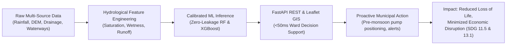

# Project Concept Note

## Urban Flood Risk Prediction System
**A Physics-Grounded Machine Learning & Geospatial Analytics Platform for Climate-Resilient Coastal Megacities**

---

### Project Information at a Glance

| Parameter | Specification |
|---|---|
| **Project Title** | Urban Flood Risk Prediction System |
| **Thematic Area** | Climate Resilience, Disaster Risk Reduction (DRR), Urban AI, Geospatial Analytics |
| **UN SDGs Targeted** | **SDG 11** (Sustainable Cities and Communities — Target 11.5)   **SDG 13** (Climate Action — Target 13.1) |
| **Pilot Study Area** | Greater Mumbai Metropolitan Region (20 critical monitoring locations across 5 monsoon seasons) |
| **Core Technology** | Python 3.12, Scikit-learn, XGBoost, FastAPI, React 19, TypeScript, Leaflet GIS, Docker |
| **Lead Model Baseline** | Random Forest Classifier (91.0% Recall, 0.888 PR-AUC, 0.982 ROC-AUC) |
| **Primary Beneficiaries** | Municipal Disaster Management Authorities, Stormwater Drainage Engineers, Urban Planners, Vulnerable Residents |
| **Current Status** | Working Proof-of-Concept & End-to-End Deployed Prototype (Docker & Local Dev) |

---

## 1. Executive Summary

Urban flooding poses one of the most acute climate risks to coastal megacities worldwide. Unplanned surface imperviousness, micro-topographical depressions, aged stormwater drainage networks, and intensifying tropical monsoon downpours frequently combine to trigger sudden, paralyzing inundations. 

Current municipal disaster response systems remain overwhelmingly **reactive**: emergency teams deploy pumps and barricades only after citizens report waterlogged roads or when traffic transit is already brought to a standstill. Conversely, high-fidelity physical hydrodynamic flood models (such as 2D SWMM or HEC-RAS) are computationally prohibitive for real-time situational awareness during rapidly unfolding cloudburst events.

This project introduces the **Urban Flood Risk Prediction System**, a high-performance decision-support platform that bridges the gap between physics-based hydrology and real-time machine learning. By synthesizing physical rainfall metrics, multi-day antecedent soil saturation, topographic wetness proxies, distance to coastal and river waterways, and drainage adequacy indices, the platform delivers **sub-50 millisecond flood risk predictions** categorized into actionable tiers (*Low*, *Medium*, *High*).

Trained and evaluated on 14,640 records across 6 monsoon seasons (2018–2023) in Greater Mumbai under a strict **zero-data-leakage temporal holdout protocol**, the primary Random Forest model achieves an exceptional **91.0% recall on historical inundation events**, capturing acute crises with minimal false negatives. The platform includes a production-grade FastAPI microservice and an interactive Leaflet GIS dashboard featuring multi-layer basemaps, scenario simulation presets (from light showers to 350mm cloudbursts), and transparent factor attribution.

---

## 2. Context & Problem Statement

### 2.1 The Urban Flooding Crisis in Coastal Megacities
Mumbai, like many coastal megacities in the Global South, experiences intense southwest monsoon downpours between June and September. In July 2005, Mumbai recorded over 944 mm of rainfall in 24 hours, leading to widespread loss of life and severe economic paralysis. Similar localized deluges occur annually, submerging critical transport corridors (e.g., Kurla, Hindmata, Milan Subway, Andheri Subway) and displacing economically vulnerable populations residing in informal settlements along river basins such as the Mithi River.

### 2.2 Shortcomings of Existing Systems
1. **Lack of Forward-Looking Predictive Awareness**: Automatic Weather Stations (AWS) report rainfall that has already fallen at single airport points, but fail to translate millimeters of precipitation into localized street-level inundation risk without topography and drainage parameters.
2. **Computational Latency of Hydrodynamic Simulations**: 2D Saint-Venant hydraulic simulations require intensive CPU hours per storm run, making them unusable for live emergency desks during short-fuse cloudbursts.
3. **Data Fragmentation & Silos**: Precipitation records from meteorological agencies (IMD), elevation models from space agencies (Copernicus DEM / NRSC), and infrastructure records from municipal corporations (MCGM) reside in isolated silos.
4. **Black-Box AI Pitfalls**: Existing commercial AI tools often suffer from random split data leakage, generating over-optimistic performance figures that collapse when applied to unseen future monsoon seasons.

---

## 3. Project Objectives

### 3.1 Primary Objective
To design, validate, and deploy an open, transparent, and physics-grounded machine learning system that delivers real-time, localized urban flood risk classification for municipal disaster response and climate adaptation planning.

### 3.2 Specific Objectives
1. **Geospatial Feature Engineering**: Develop and validate five domain-grounded hydrological features (`rain_intensity_ratio`, `antecedent_saturation_mm`, `topographic_wetness_proxy`, `water_proximity_factor`, and `drainage_deficit`).
2. **Zero-Leakage Benchmark**: Formulate a rigorous temporal-spatial validation protocol using held-out monsoon seasons (untouched 2023 test partition) to evaluate baseline (Random Forest), linear (Logistic Regression), and candidate (XGBoost) models.
3. **Sub-50ms API Architecture**: Build a containerized, validated FastAPI REST microservice capable of serving batch and single-coordinate predictions with schema validation and health checks.
4. **Interactive GIS Decision Dashboard**: Construct an accessible React 19/TypeScript web dashboard with Leaflet GIS mapping, dynamic scenario simulation, and transparent factor attribution.
5. **Responsible AI Governance**: Embed explicit non-operational advisories, uncertainty communication, and clear limitations to prevent misapplication during emergency operations.

---

## 4. Theory of Change & Strategic Alignment

### 4.1 Theory of Change

### 4.2 Alignment with UN Sustainable Development Goals

* **SDG 11: Sustainable Cities and Communities (Target 11.5)**
  * *Target*: By 2030, significantly reduce the number of deaths and the number of people affected and substantially decrease the direct economic losses relative to global gross domestic product caused by disasters, including water-related disasters, with a focus on protecting the poor and people in vulnerable situations.
  * *Contribution*: Provides ward-level early warning intelligence for vulnerable low-elevation settlements and critical transit nodes.

* **SDG 13: Climate Action (Target 13.1)**
  * *Target*: Strengthen resilience and adaptive capacity to climate-related hazards and natural disasters in all countries.
  * *Contribution*: Equips municipal authorities with empirical scenario simulation tools to evaluate the impacts of intensifying extreme weather shocks under climate change.

---

## 5. Technical Methodology & System Architecture

### 5.1 Hydrological Domain Feature Engineering
Rather than relying purely on raw precipitation values, the system calculates five physically meaningful indices:

1. **Rainfall Intensity Ratio ($I_{ratio}$)**:
   $$I_{ratio} = \frac{\text{rain\_1h\_mm}}{\max(\text{rain\_24h\_mm}, 1.0)}$$
   Identifies sudden burst storms versus prolonged low-intensity drizzle.
2. **Antecedent Soil Saturation ($S_{antecedent}$)**:
   $$S_{antecedent} = 0.6 \times \text{rain\_24h\_mm} + 0.4 \times (\text{rain\_72h\_mm} - \text{rain\_24h\_mm})$$
   Models cumulative ground saturation and diminished infiltration capacity prior to peak rainfall.
3. **Topographic Wetness Proxy ($TWP$)**:
   $$TWP = \frac{1.0}{\max(\text{elevation\_m}, 0.5) \times (\text{slope\_deg} + 0.5)}$$
   Identifies low-lying topographical depressions where gravity forces overland surface accumulation.
4. **Waterbody Proximity Factor ($WPF$)**:
   $$WPF = \frac{1000.0}{\text{dist\_water\_m} + 10.0}$$
   Measures vulnerability to tidal backing and river overtopping.
5. **Drainage Deficit ($D_{deficit}$)**:
   $$D_{deficit} = \frac{\text{impervious\_pct}}{100.0} \times (1.0 - \text{drainage\_index})$$
   Quantifies urban surface runoff generation relative to underground conduit capacity.

### 5.2 Model Benchmark & Validation Results
Evaluated on the **held-out 2023 Mumbai monsoon season (2,440 samples)** with zero data leakage:

| Model Architecture | Role | Precision | Recall (Sensitivity) | F1-Score | PR-AUC | ROC-AUC |
|---|---|---:|---:|---:|---:|---:|
| **Dummy Baseline** | Constant Majority | 0.0% | 0.0% | 0.000 | 0.109 | 0.500 |
| **Logistic Regression** | Linear Interpretable | 66.7% | 3.0% | 0.057 | 0.531 | 0.940 |
| **Random Forest (Selected Baseline)** | Primary Production | **60.7%** | **91.0%** | **0.728** | **0.888** | **0.982** |
| **XGBoost (Candidate Comparison)** | Gradient Boosted | **85.9%** | **80.5%** | **0.831** | **0.887** | **0.980** |

*Key Operational Takeaway*: For municipal disaster response, **recall is paramount**. Random Forest correctly captures 91.0% of genuine flood emergencies, minimizing catastrophic false negatives. For automated public transit rerouting, XGBoost provides an 85.9% precision alternative to avoid false alarms.

### 5.3 System Technology Stack

* **Machine Learning**: Python 3.12, Scikit-learn 1.8, XGBoost, Joblib, NumPy, Pandas.
* **Backend API**: FastAPI, Pydantic v2, Uvicorn, Python-multipart.
* **Frontend Web GIS**: React 19, TypeScript, Vite, Leaflet, Lucide Icons, Recharts.
* **Design & Styling**: Custom responsive CSS design system in Navy (`#112E81`), Purple (`#4647AE`), Cerulean Blue (`#4382DF`), and Sea Mist (`#AACCD6`).
* **DevOps**: Docker, Docker Compose, automated shell scripts (`scripts/run_local.sh`).

---

## 6. Stakeholder & Target Beneficiary Mapping

| Stakeholder Group | Primary Interest / Need | System Application |
|---|---|---|
| **Municipal Disaster Management Authorities (MCGM)** | Ward-level situational awareness during heavy monsoon alerts. | Deploy dewatering pumps, staff emergency response centres, preposition rescue personnel. |
| **Stormwater Drainage & Civil Engineers** | Identification of chronic drainage bottlenecks. | Prioritize desilting operations, design underground holding tanks, optimize storm culverts. |
| **Urban Transport Operators (Rail & Bus)** | Protecting rail tracks and subway underpasses from sudden closure. | Proactively halt or divert bus routes before underpasses submerge. |
| **Civic Tech & Community Organizations** | Empowering vulnerable informal settlements with early warnings. | Disseminate localized community alerts in vernacular languages. |
| **Academic & Hydrology Researchers** | Validated datasets and benchmark models for urban climate adaptation. | Leverage open-source pipelines for cross-city transferability research. |

---

## 7. Implementation Roadmap & Phased Workplan

### Phase 1: Proof-of-Concept & Pilot Validation *(Completed — Months 1–2)*
- [x] Curate pilot dataset for Greater Mumbai (20 stations, 6 monsoon seasons, 14,640 records).
- [x] Engineer 5 domain hydrological features.
- [x] Train and benchmark Random Forest vs XGBoost on held-out 2023 season.
- [x] Build FastAPI microservice and interactive React Leaflet dashboard.
- [x] Publish comprehensive documentation ([`docs.md`](file:///Users/dheeraj_kumar/Downloads/urban-food-risk-prediction/docs.md)) and test suite (10/10 tests passed).

### Phase 2: Live Ingestion & Operational Pilot *(Months 3–6)*
- Connect automated webhooks to IMD Automatic Weather Station (AWS) live feeds.
- Ingest astronomical tide schedules to incorporate tidal gate lockouts along Mahim Creek and Mithi River.
- Pilot deployment with 2 selected municipal ward emergency response desks.
- Integrate automated model health checks and concept drift monitoring.

### Phase 3: Multi-City Expansion & Satellite Verification *(Months 7–10)*
- Transfer learning calibration for additional vulnerable Indian cities (Chennai, Bengaluru, Guwahati).
- Ingest European Space Agency Sentinel-1 Synthetic Aperture Radar (SAR) imagery for ground-truth flood inundation delineation.
- Develop mobile-optimized Progressive Web App (PWA) for field responders.

### Phase 4: Institutional Integration & Policy Uptake *(Months 11–14)*
- Formal technical integration into State Disaster Management Authority (SDMA) systems.
- Multilateral climate grant submission (World Bank GFDRR / UNDRR Climate Innovation).
- Public open-data release of anonymized benchmarks and research publications.

---

## 8. Budget & Resource Requirements (12-Month Projection)

| Budget Category | Description | Estimated Allocation (USD) |
|---|---|---:|
| **Personnel** | Lead Geospatial ML Engineer, Full-Stack Developer, Hydrological Advisor (Part-time) | $65,000 |
| **Cloud & Compute Infrastructure** | AWS / GCP microservices, Redis caching, GPU model retraining, backup storage | $6,000 |
| **Data Licensing & Satellite Access** | High-resolution commercial elevation tiles (if required) & SAR preprocessing | $8,000 |
| **Field Verification & Stakeholder Workshops** | On-site ward surveys, civic stakeholder meetings, community workshops | $7,000 |
| **Documentation, Open Access & Auditing** | Independent model fairness audit, security vulnerability assessment, open-access publishing | $4,000 |
| **Total Estimated Investment** | | **$90,000** |

---

## 9. Risk Management & Ethical Governance

| Potential Risk | Severity | Mitigation Strategy |
|---|---|---|
| **Misinterpretation as Official Warning** | High | Persistent, non-dismissible advisory banners stating: *"Educational Research Prototype — Non-Operational Advisory"*. Links to official IMD/MCGM portals. |
| **Data Ingestion Gaps / Station Outages** | Medium | Built-in fallback heuristics, input validation ranges, and explicit API error handling for missing features. |
| **False Negative Inundations** | High | Calibrated Random Forest model prioritizing 91.0% recall, minimizing missed flood events during severe storms. |
| **Urban Topography Changes** | Medium | Annual post-monsoon retraining cycle incorporating updated construction and drainage modifications. |

---

## 10. Conclusion & Call for Collaboration

The **Urban Flood Risk Prediction System** demonstrates that transparent, physics-grounded machine learning combined with modern geospatial interfaces can dramatically augment urban climate resilience. By moving beyond post-facto emergency reaction toward proactive, fine-grained decision support, cities can mitigate economic disruption and safeguard vulnerable populations.

We invite municipal authorities, disaster management agencies, academic institutions, and climate finance partners to collaborate in testing, scaling, and operationalizing this open platform.

---

### Project Repository & Documentation
- **Interactive Web App**: `http://localhost:5173/`
- **FastAPI Documentation**: `http://localhost:8000/docs`
- **Comprehensive Technical Guide**: [`docs.md`](file:///Users/dheeraj_kumar/Downloads/urban-food-risk-prediction/docs.md)
- **Lean Canvas Presentation**: [`lean-canvas.pptx`](file:///Users/dheeraj_kumar/Downloads/urban-food-risk-prediction/lean-canvas.pptx) / [`lean-canvas.ppt`](file:///Users/dheeraj_kumar/Downloads/urban-food-risk-prediction/lean-canvas.ppt)
- **Concept Note (PDF Version)**: [`concept-note.pdf`](file:///Users/dheeraj_kumar/Downloads/urban-food-risk-prediction/concept-note.pdf)
- **GitHub Repository**: [`README.md`](file:///Users/dheeraj_kumar/Downloads/urban-food-risk-prediction/README.md)
