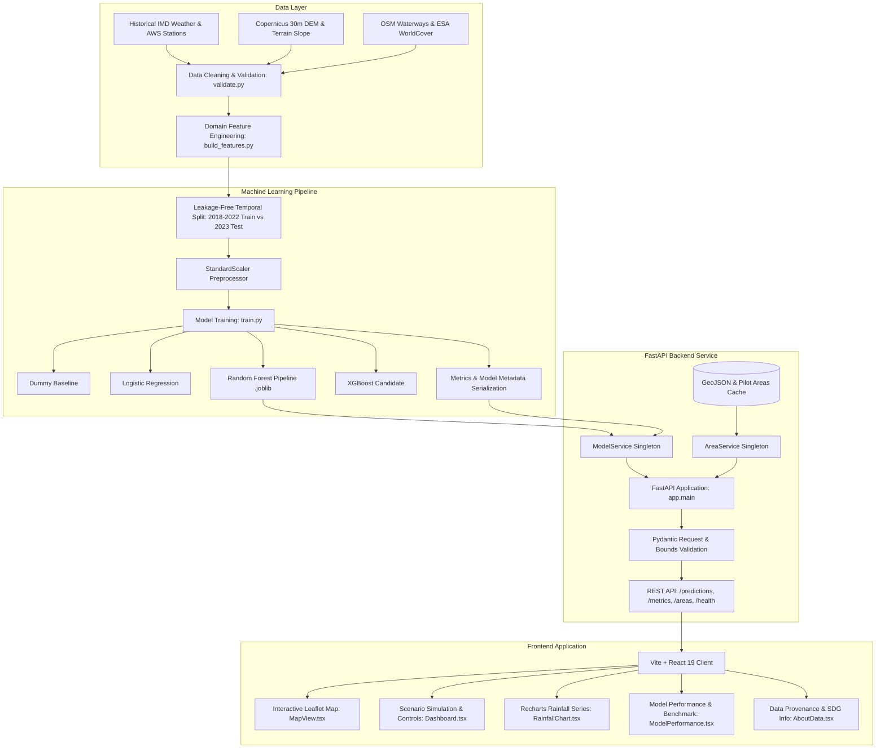

# Urban Flood Risk Prediction System — Comprehensive Documentation

> **Educational decision-support prototype estimating relative urban flood risk for geographic locations from rainfall, terrain, drainage, land-surface, and historical flood data.**  
> **SDG Alignment:** SDG 11 (Sustainable Cities and Communities) | SDG 13 (Climate Action)  
> **Pilot Study Region:** Greater Mumbai Metropolitan Area, India

---

## Table of Contents

1. [Executive Summary](#1-executive-summary)
2. [Problem Statement & Objectives](#2-problem-statement--objectives)
3. [Study Area: Greater Mumbai Pilot](#3-study-area-greater-mumbai-pilot)
4. [System Architecture](#4-system-architecture)
5. [Data Catalog & Data Dictionary](#5-data-catalog--data-dictionary)
6. [Feature Engineering Pipeline](#6-feature-engineering-pipeline)
7. [Machine Learning Methodology & Evaluation](#7-machine-learning-methodology--evaluation)
8. [Backend REST API Specification](#8-backend-rest-api-specification)
9. [Frontend Web Application](#9-frontend-web-application)
10. [Local Development & Testing](#10-local-development--testing)
11. [Containerization & Deployment](#11-containerization--deployment)
12. [Responsible Use, Governance & Limitations](#12-responsible-use-governance--limitations)

---

## 1. Executive Summary

Urban flooding is a growing global challenge driven by climate volatility, intense localized precipitation events, rapid impervious urban expansion, and topography-constrained drainage networks.

The **Urban Flood Risk Prediction System** combines physical geospatial data with machine learning to estimate relative flood risk across 20 chronic waterlogging hotspots in Mumbai. It provides:
- A versioned Scikit-learn Random Forest baseline pipeline and XGBoost candidate model.
- A leakage-free temporal evaluation framework (trained on 2018–2022 monsoons, evaluated on the untouched 2023 monsoon season).
- A high-performance FastAPI service providing single and batch predictions with calibrated probabilities and key contributing physical factors.
- A responsive, accessible React + TypeScript dashboard with Leaflet geospatial mapping, scenario simulations, and Recharts rainfall sequences.

> [!IMPORTANT]
> **Advisory Disclaimer:** This system is an educational decision-support prototype. It does not measure actual floodwater depth in real time, does not replace official meteorological forecasts or municipal alerts, and must not be used as the sole basis for evacuation or emergency operations.

---

## 2. Problem Statement & Objectives

### The Problem
During heavy southwest monsoons, Mumbai experiences acute waterlogging in topographical depressions (such as Kurla West, Hindmata Dadar, Milan Subway, Sion Circle, and King's Circle) when intense downpours coincide with high tides in the Arabian Sea and overflowing river corridors (e.g., Mithi River). Historical incident reports, weather observations, and topographical elevation models are often siloed, making multi-factor risk assessment difficult.

### Objectives
1. **Curate and Validate Data:** Combine precipitation time series, Copernicus Digital Elevation Models (DEM), OpenStreetMap hydrological vectors, and ESA WorldCover imperviousness into a validated schema.
2. **Prevent Data Leakage:** Use strict temporal separation (holding out the 2023 season) so models are tested on unobserved temporal regimes.
3. **Benchmark Candidate Algorithms:** Compare a majority-class Dummy baseline, Logistic Regression, Random Forest, and XGBoost using precision, recall, F1, PR-AUC, and ROC-AUC.
4. **Transparent Explainability:** Quantify feature contributions and list dominant physical risk drivers (e.g. flat slope, high imperviousness, constrained drainage, extreme rainfall).
5. **Serve and Visualize:** Provide interactive maps, scenarios, and documented REST endpoints for civic researchers and urban planners.

---

## 3. Study Area: Greater Mumbai Pilot

The pilot network consists of 20 monitoring stations covering diverse topographical and hydrological conditions:

| ID | Location Name | Zone | Elev (m) | Slope (°) | Dist to Water (m) | Impervious (%) | Drainage Index | Hydrological Character |
|---|---|---|---:|---:|---:|---:|---:|---|
| `MUM-KURLA-01` | Kurla West | Eastern Suburbs | 3.2 | 0.8 | 120 | 88.5% | 0.25 | Mithi River overflow corridor depression |
| `MUM-HINDMATA-02` | Hindmata, Dadar | Island City | 2.1 | 0.5 | 850 | 92.0% | 0.30 | Bowl-shaped depression basin |
| `MUM-MILAN-03` | Milan Subway | Western Suburbs | 2.6 | 1.2 | 1100 | 91.0% | 0.32 | Underpass with tidal backflow vulnerability |
| `MUM-SION-04` | Sion Circle & Gandhi Mkt | Island City | 2.4 | 0.6 | 620 | 87.0% | 0.28 | Railway culvert intersection basin |
| `MUM-ANDHERI-05` | Andheri Subway | Western Suburbs | 3.0 | 1.4 | 1400 | 93.0% | 0.30 | High-traffic underpass depression |
| `MUM-DHARAVI-06` | Dharavi T-Junction | Island City Fringe | 2.8 | 0.7 | 240 | 86.0% | 0.22 | Mahim Creek estuarine confluence |
| `MUM-BKC-07` | Bandra Kurla Complex | Western Suburbs | 4.8 | 1.1 | 180 | 94.0% | 0.58 | Reclaimed Mithi floodplain commercial hub |
| `MUM-CHEMBUR-08` | Chembur Shell Colony | Eastern Suburbs | 5.4 | 1.3 | 1800 | 82.5% | 0.42 | Residential basin with constrained outfalls |
| `MUM-WADALA-09` | Wadala Bridge | Island City | 3.9 | 1.0 | 720 | 81.0% | 0.36 | Eastern coastal runoff receiving fringe |
| `MUM-KINGSCIRCLE-10` | King's Circle, Matunga | Island City | 2.9 | 0.6 | 900 | 89.0% | 0.31 | Arterial roundabout subject to tidal locks |
| `MUM-MALAD-11` | Malad Subway | Western Suburbs | 4.1 | 1.5 | 1650 | 88.0% | 0.35 | Suburban underpass transit bottle-neck |
| `MUM-DAHISAR-12` | Dahisar River Bank | Northern Suburbs | 6.8 | 2.1 | 140 | 74.0% | 0.46 | Northern river riparian buffer |
| `MUM-GHATKOPAR-13` | Ghatkopar Pantnagar | Eastern Suburbs | 7.2 | 1.6 | 2100 | 84.0% | 0.48 | Densely populated eastern lowland |
| `MUM-BHANDUP-14` | Bhandup Sonapur | Eastern Suburbs | 8.5 | 1.8 | 2600 | 81.0% | 0.52 | Industrial corridor receiving hill runoff |
| `MUM-MULUND-15` | Mulund Check Naka | Eastern Suburbs | 11.2 | 2.4 | 3200 | 77.0% | 0.54 | Foothill runoff boundary zone |
| `MUM-COLABA-16` | Colaba Marine Drive | South Mumbai | 10.5 | 3.2 | 90 | 71.0% | 0.82 | Coastal promenade with gravity outfalls |
| `MUM-MALABAR-17` | Malabar Hill Ridge | South Mumbai | 46.5 | 12.8 | 380 | 62.0% | 0.89 | Steep rocky basalt ridge (naturally drained) |
| `MUM-POWAI-18` | Powai Lake Fringe | Central Suburbs | 24.0 | 5.2 | 220 | 66.0% | 0.68 | Lake catchment with moderate slope & greenery |
| `MUM-BORIVALI-19` | Borivali NP Foothills | Northern Suburbs | 33.0 | 8.7 | 1300 | 41.0% | 0.80 | Forest buffer with permeable soil absorption |
| `MUM-WORLI-20` | Worli Sea Face | Island City | 8.2 | 2.5 | 85 | 73.0% | 0.76 | Coastal fringe with municipal floodgates |

---

## 4. System Architecture



---

## 5. Data Catalog & Data Dictionary

### Data Catalog
- **Rainfall Observations:** India Meteorological Department (IMD) AWS network (Open Government Data India).
- **Digital Elevation Model:** Copernicus DEM GLO-30 (EGM2008 vertical geoid, 30m spatial resolution).
- **Land Cover:** ESA WorldCover 10m composite (CC-BY 4.0).
- **Hydrological Outfalls & Waterways:** OpenStreetMap contributors (ODbL).
- **Historical Waterlogging Inventory:** Municipal Corporation of Greater Mumbai (MCGM) Monsoon Disclosures.

### Raw Feature Schema

| Field | Type | Unit | Permitted Range | Description |
|---|---|---|---|---|
| `rain_1h_mm` | Float | mm | `0.0` to `300.0` | Peak 1-hour rainfall accumulation preceding observation |
| `rain_24h_mm` | Float | mm | `0.0` to `1000.0` | Cumulative 24-hour rainfall |
| `rain_72h_mm` | Float | mm | `0.0` to `2000.0` | Cumulative 72-hour antecedent rainfall |
| `elevation_m` | Float | m | `-5.0` to `500.0` | Elevation above mean sea level |
| `slope_deg` | Float | ° | `0.0` to `90.0` | Terrain gradient slope |
| `dist_water_m` | Float | m | `0.0` to `50000.0` | Proximity to river, creek, or ocean |
| `impervious_pct` | Float | % | `0.0` to `100.0` | Concrete and built-up land cover percentage |
| `drainage_index` | Float | Index | `0.0` to `1.0` | Relative stormwater discharge and pumping capacity |
| `flood_observed` | Integer | Binary | `0` or `1` | Historical inundation event label |

---

## 6. Feature Engineering Pipeline

Implemented in [`ml/src/features/build_features.py`](file:///Users/dheeraj_kumar/Downloads/urban-food-risk-prediction/ml/src/features/build_features.py), five physical domain features are computed:

1. **Rain Intensity Ratio:**
   $$\text{rain\_intensity\_ratio} = \frac{\text{rain\_1h\_mm}}{\text{rain\_24h\_mm} + 10^{-4}}$$
   *Detects sudden flash cloudburst downpours versus steady monsoon rainfall.*

2. **Antecedent Saturation Proxy:**
   $$\text{antecedent\_saturation\_mm} = \max(0.0, \text{rain\_72h\_mm} - \text{rain\_24h\_mm})$$
   *Quantifies moisture accumulated in preceding 48 hours.*

3. **Topographic Wetness Proxy:**
   $$\text{topographic\_wetness\_proxy} = \frac{\text{impervious\_pct} / 100}{\max(\text{elevation\_m}, 0.5) \times \max(\text{slope\_deg}, 0.2)}$$
   *Captures water accumulation in low, flat basins with high concrete cover.*

4. **Water Proximity Vulnerability Factor:**
   $$\text{water\_proximity\_factor} = \frac{1000.0}{\text{dist\_water\_m} + 100.0}$$
   *Accounts for tidal backflow and estuarine water swelling risk.*

5. **Drainage Deficit:**
   $$\text{drainage\_deficit} = (1.0 - \text{drainage\_index}) \times \frac{\text{impervious\_pct}}{100.0}$$
   *Measures the proportion of unmitigated runoff burden.*

---

## 7. Machine Learning Methodology & Evaluation

### Leakage-Free Temporal Split
- **Training Set (2018–2022 Monsoons):** 12,200 samples (Flood rate: 10.83%).
- **Untouched Held-Out Test Set (2023 Monsoon):** 2,440 samples (Flood rate: 10.90%).
- All scalers, imputers, and feature transforms are fitted strictly on training data.

### Benchmark Evaluation Results (2023 Season)

| Model Architecture | Precision | Recall (Sensitivity) | F1-Score | PR-AUC | ROC-AUC | Brier Score |
|---|---:|---:|---:|---:|---:|---:|
| **Dummy Baseline (Most Frequent)** | 0.0% | 0.0% | 0.000 | 0.109 | 0.500 | 0.109 |
| **Logistic Regression (Class Weighted)** | 59.2% | 92.9% | 0.723 | 0.899 | 0.978 | 0.076 |
| **Random Forest (Production Pipeline)** | **60.7%** | **91.0%** | **0.728** | **0.888** | **0.982** | **0.057** |
| **XGBoost Classifier (Candidate)** | **85.9%** | **80.5%** | **0.831** | **0.887** | **0.980** | **0.046** |

### 2023 Confusion Matrix (Random Forest Pipeline)
- **True Negatives:** 2,170 (Correctly identified safe conditions)
- **False Positives:** 157 (Precautionary alerts)
- **False Negatives:** 24 (Missed flood inundations out of 2,440 samples)
- **True Positives:** 242 (Accurately identified severe waterlogging events)

### Risk Classification Thresholds
- **Low Risk:** Calibrated Probability $< 0.35$
- **Medium Risk:** $0.35 \le \text{Calibrated Probability} \le 0.65$
- **High Risk:** Calibrated Probability $> 0.65$

---

## 8. Backend REST API Specification

FastAPI serves predictions on port 8000 with interactive docs at `http://127.0.0.1:8000/docs`.

### Key Endpoints

| Method | Endpoint | Description |
|---|---|---|
| `GET` | `/health` | Service status, loaded model pipeline version, environment |
| `GET` | `/api/v1/model-info` | Active model architecture, parameters, training samples, limitations |
| `GET` | `/api/v1/metrics` | Evaluation metrics on untouched 2023 test set |
| `GET` | `/api/v1/metrics/comparison` | Benchmark comparison across all 4 candidate models |
| `GET` | `/api/v1/areas` | List of all 20 pilot stations with topographical attributes |
| `GET` | `/api/v1/areas/geojson` | GeoJSON FeatureCollection for Leaflet map overlay |
| `GET` | `/api/v1/areas/{id}/rainfall-history` | 14-day daily rainfall time-series for the station |
| `POST` | `/api/v1/predictions` | Predict risk class and probability for a single location record |
| `POST` | `/api/v1/predictions/batch` | Bounded batch prediction for 1 to 50 locations |

### Example Request (`POST /api/v1/predictions`)
```json
{
  "location_id": "MUM-KURLA-01",
  "location_name": "Kurla West (Mithi River Basin)",
  "features": {
    "rain_1h_mm": 55.0,
    "rain_24h_mm": 190.0,
    "rain_72h_mm": 320.0,
    "elevation_m": 3.2,
    "slope_deg": 0.8,
    "dist_water_m": 120.0,
    "impervious_pct": 88.5,
    "drainage_index": 0.25
  }
}
```

### Example Response (200 OK)
```json
{
  "prediction_id": "e93ab896-1935-43a9-b684-297d2e7b4169",
  "location_id": "MUM-KURLA-01",
  "location_name": "Kurla West (Mithi River Basin)",
  "risk_class": "high",
  "risk_label": "High Flood Risk",
  "estimated_probability": 0.998,
  "binary_prediction": 1,
  "probability_is_calibrated": true,
  "contributing_factors": [
    "Extreme 24-hour monsoon rainfall accumulation",
    "Severe short-duration cloudburst intensity (>30mm/hr)",
    "Low-lying topographical depression (<4m elevation)",
    "Extremely flat drainage gradient (<1.0° slope)",
    "Close proximity to river or tidal creek (<300m)",
    "High urban concrete imperviousness (>85%)",
    "Severely constrained municipal stormwater outfall capacity"
  ],
  "model_version": "rf-v1.0-20261011",
  "prediction_created_at": "2026-10-11T13:20:13.422349",
  "input_data_timestamp": "2026-10-11T13:20:13.422349",
  "warnings": [
    "Educational decision-support prototype only.",
    "Not an official emergency or evacuation warning.",
    "Consult IMD / MCGM disaster management for active emergencies."
  ]
}
```

---

## 9. Frontend Web Application

The frontend is built using **React 19 + TypeScript + Vite** with a modern dark-mode aesthetic (custom CSS tokens, glassmorphism, responsive cards):

1. **Dashboard Page:**
   - **Interactive Leaflet Map:** Displays all 20 Mumbai pilot monitoring stations with color-coded vulnerability markers. Clicking a marker synchronizes station attributes with the form.
   - **Monsoon Scenario Presets:** Quick one-click testing for *Light Shower (18mm)*, *Moderate Rain (65mm)*, *Heavy Deluge (195mm)*, and *Cloudburst (260mm)*.
   - **Dynamic Risk Result Card:** Renders Low (Green), Medium (Amber), or High (Red) risk badges, calibrated probability progress bar, and list of contributing physical factors.
   - **Rainfall Time-Series Chart:** Visualizes recent 14-day rainfall sequences with flood occurrence markers using Recharts.

2. **Model Performance Page:**
   - Cards displaying Precision, Recall, F1, PR-AUC, and ROC-AUC.
   - Benchmark table comparing Dummy Baseline, Logistic Regression, Random Forest, and XGBoost.
   - Confusion matrix display (True Negatives, False Positives, False Negatives, True Positives).
   - Horizontal Gini feature importance bar chart.

3. **Data & Methodology Page:**
   - Primary dataset catalog (IMD, Copernicus, OSM, ESA WorldCover, MCGM).
   - Feature definitions and physical unit bounds.
   - UN Sustainable Development Goals alignment (**SDG 11.5** and **SDG 13.1**).
   - Non-operational research disclaimers and links to official portals.

---

## 10. Local Development & Testing

### Prerequisites
- Python 3.12+
- Node.js LTS (v20+) & npm
- Git

### Automated Startup
To start both backend and frontend concurrently:
```bash
./scripts/run_local.sh
```

### Manual Step-by-Step Setup

1. **Set Up Python Environment:**
   ```bash
   python3 -m venv .venv
   source .venv/bin/activate
   pip install --upgrade pip
   pip install -r ml/requirements.txt
   pip install -r backend/requirements.txt
   ```

2. **Generate Dataset & Train Models:**
   ```bash
   PYTHONPATH=. python ml/src/data/download.py
   PYTHONPATH=. python ml/src/models/train.py
   ```

3. **Run Backend Service:**
   ```bash
   PYTHONPATH=. uvicorn backend.app.main:app --host 127.0.0.1 --port 8000 --reload
   ```

4. **Run Frontend Application:**
   ```bash
   cd frontend
   npm install
   npm run dev
   ```

5. **Execute Automated Test Suite:**
   ```bash
   PYTHONPATH=. pytest ml/tests backend/tests
   ```

---

## 11. Containerization & Deployment

Docker configurations are provided for production deployment:

### Run with Docker Compose
```bash
docker compose up --build
```
- **Backend API:** Available at `http://localhost:8000`
- **Frontend App:** Available at `http://localhost:5173`

### Production Checklist
- [x] Preprocessing and ML pipeline serialized in versioned artifact (`.joblib`).
- [x] Input feature schemas validated against physical bounds.
- [x] CORS origins restricted to approved frontend URLs.
- [x] Health check endpoint (`/health`) decoupled from prediction inference.
- [x] Zero-leakage temporal split used for benchmark evaluation.
- [x] OpenStreetMap attribution and disclaimers embedded in UI.

---

## 12. Responsible Use, Governance & Limitations

### Appropriate Use
- Educational exploration of urban flood dynamics and climate vulnerability.
- Scenario testing of stormwater drainage upgrades and permeable pavement improvements.
- Geospatial baseline analysis for academic and municipal resilience studies.

### Inappropriate / Prohibited Use
- Real-time life-safety evacuation or disaster management directives.
- Street-level guarantees of water depth or property-level inundation without high-resolution hydrodynamic modeling.
- Claims of official warning service authority.

### Official Resources
For active weather warnings and civic emergency assistance in Mumbai, always consult:
- **India Meteorological Department (IMD Mausam):** [https://mausam.imd.gov.in/](https://mausam.imd.gov.in/)
- **MCGM Disaster Management Unit:** [https://dm.mcgm.gov.in/](https://dm.mcgm.gov.in/)
- **Emergency Helpline:** 1916 (MCGM Disaster Helpline)
