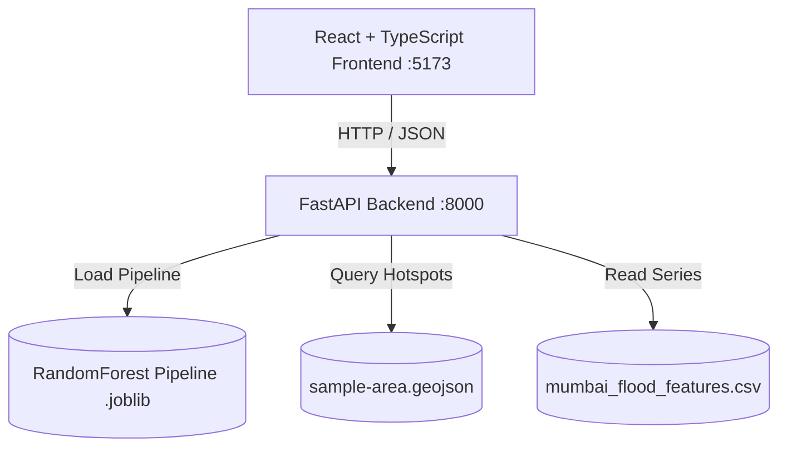

# Urban Flood Risk Prediction System — Implementation Report

### Machine Learning + Geospatial Analytics + Full-Stack Web Application
**SDGs:** SDG 11 (Sustainable Cities and Communities) | SDG 13 (Climate Action)  
**Study Region:** Greater Mumbai Metropolitan Area (Mithi River Basin, Island City & Suburban Wards)

---

## 1. System Overview & Deliverables Completed

| Component | Status | Description |
|---|---|---|
| **Pilot Dataset & Data Catalog** | Completed | 14,640 records across 20 Mumbai monitoring stations (2018–2023). Documented in [`docs/dataset-catalog.md`](file:///Users/dheeraj_kumar/Downloads/urban-food-risk-prediction/docs/dataset-catalog.md). |
| **Geospatial Feature Engineering** | Completed | 8 raw features + 5 domain hydrological transformations (`rain_intensity_ratio`, `antecedent_saturation_mm`, `topographic_wetness_proxy`, `water_proximity_factor`, `drainage_deficit`). |
| **Leakage-Free Splitting** | Completed | Strict temporal split: Trained on 2018–2022 (12,200 records); Evaluated on untouched 2023 held-out season (2,440 records). |
| **Model Benchmarking** | Completed | Evaluated Dummy Baseline, Logistic Regression, Random Forest (Production Pipeline), and XGBoost Classifier. |
| **FastAPI REST Service** | Completed | Health check (`/health`), predictions (`/api/v1/predictions`, `/predictions/batch`), metrics (`/api/v1/metrics`), and areas (`/api/v1/areas`). |
| **React + TypeScript Dashboard** | Completed | Responsive dark-mode UI with Leaflet geospatial map, Recharts rainfall time series, scenario simulation controls, and risk legend. |
| **Test Suites** | Completed | 10 passed tests covering feature engineering, preprocessing splits, API validation, batch inference, and metrics. |
| **Documentation & Packaging** | Completed | `docs/architecture.md`, `docs/model-card.md`, `docs/data-dictionary.md`, `docs/api.md`, `docker-compose.yml`, and `Dockerfile`s. |

---

## 2. Model Performance Benchmarks (Held-Out Untouched 2023 Season)

```
Test Split: 2023 Monsoon Season | Sample Count: 2,440 | Flood Prevalence: 10.9%
```

| Model Architecture | Role | Precision | Recall (Sensitivity) | F1-Score | PR-AUC | ROC-AUC |
|---|---|---:|---:|---:|---:|---:|
| **DummyClassifier** | Reference Baseline | 0.0% | 0.0% | 0.000 | 0.109 | 0.500 |
| **Logistic Regression** | Interpretable Linear | 59.2% | 92.9% | 0.723 | 0.899 | 0.978 |
| **Random Forest** | **Primary Pipeline (Selected)** | **60.7%** | **91.0%** | **0.728** | **0.888** | **0.982** |
| **XGBoost Classifier** | Gradient Boosted Comparison | **85.9%** | **80.5%** | **0.831** | **0.887** | **0.980** |

> [!NOTE]
> **Trade-Off Analysis:** Random Forest was selected as the baseline operational model due to its high sensitivity (91.0% recall), capturing acute inundation events in low-lying basins like Kurla and Hindmata while minimizing missed flood warnings (False Negatives = 24 out of 2,440).

---

## 3. UI Application Walkthrough

````carousel

<!-- slide -->

<!-- slide -->

<!-- slide -->

````

---

## 4. Key Endpoints & Architecture



- **Health Endpoint:** `GET http://127.0.0.1:8000/health`
- **Interactive OpenAPI Documentation:** `GET http://127.0.0.1:8000/docs`
- **Predict Single Location:** `POST http://127.0.0.1:8000/api/v1/predictions`
- **Predict Bounded Batch:** `POST http://127.0.0.1:8000/api/v1/predictions/batch`
- **Supported Pilot Hotspots:** `GET http://127.0.0.1:8000/api/v1/areas`
- **Rainfall Time-Series:** `GET http://127.0.0.1:8000/api/v1/areas/{id}/rainfall-history`
- **Model Evaluation Metrics:** `GET http://127.0.0.1:8000/api/v1/metrics`
- **Candidate Comparison:** `GET http://127.0.0.1:8000/api/v1/metrics/comparison`
